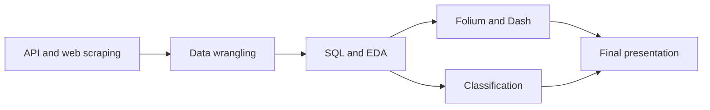

<div align="center">

# 🚀 Falcon 9 · First-Stage Landing Prediction

**IBM Data Science Professional Certificate — Applied Data Science Capstone**

*From historical launch records to exploratory analysis, interactive maps, dashboards, and machine learning.*


</div>

---

## Overview

This repository archives my work for the **IBM Applied Data Science Capstone**, investigating a focused question:

> **Can features of historical Falcon 9 launches be used to classify whether the first stage lands successfully?**

The project is a complete **educational data science workflow**, not an operational flight prediction system or an original claim about SpaceX performance. Its contribution is practical: collecting and preparing data, exploring patterns, building visual analytics, and testing classification methods while critically examining their limitations.

## Workflow



| Stage | What it covers | Evidence |
|:---|:---|:---|
| **01 · Collect** | SpaceX API lab and Wikipedia web scraping | Original notebooks, historical CSV snapshots |
| **02 · Prepare** | Cleaning, landing labels and feature construction | Data wrangling notebook; `dataset_part_1.csv`, `dataset_part_2.csv`, `dataset_part_3.csv` |
| **03 · Explore** | SQL queries, launch-site and payload patterns | SQLite notebook, database and visualization notebook |
| **04 · Visualize** | Geospatial Folium maps and interactive Dash | Map notebook and Dash Python script |
| **05 · Predict** | Logistic Regression, SVM, Decision Tree, KNN | Classification notebook and saved evaluation output |
| **06 · Communicate** | Technical slides, conclusions, limitations | [`presentation/`](presentation/) · planned |

## Repository contents

| Location | Original files | Purpose |
|:---|:---|:---|
| [`notebooks/`](notebooks/) | 7 `.ipynb` files | The complete set of uploaded IBM course notebooks, retaining their **original filenames and cells** |
| [`data/`](data/) | `dataset_part_1.csv`, `dataset_part_2.csv`, `dataset_part_3.csv`, `spacex_web_scraped.csv`, `Spacex.csv`, `my_data1.db` | Course datasets and local SQL database |
| [`dashboard/`](dashboard/) | `spacex-dash-app.py`, `spacex_launch_dash.csv` | Plotly Dash application and its dataset |
| [`presentation/`](presentation/) | Placeholder README | Location reserved for the editable PowerPoint and final PDF |

### Notebook index

| Lab | File |
|---|---|
| API data collection | [`jupyter-labs-spacex-data-collection-api.ipynb`](notebooks/jupyter-labs-spacex-data-collection-api.ipynb) |
| Wikipedia web scraping | [`jupyter-labs-webscraping.ipynb`](notebooks/jupyter-labs-webscraping.ipynb) |
| Data wrangling | [`labs-jupyter-spacex-Data wrangling.ipynb`](notebooks/labs-jupyter-spacex-Data%20wrangling.ipynb) |
| SQL exploration | [`jupyter-labs-eda-sql-coursera_sqllite.ipynb`](notebooks/jupyter-labs-eda-sql-coursera_sqllite.ipynb) |
| EDA visualizations | [`edadataviz.ipynb`](notebooks/edadataviz.ipynb) |
| Folium maps | [`lab_jupyter_launch_site_location.ipynb`](notebooks/lab_jupyter_launch_site_location.ipynb) |
| Machine learning | [`SpaceX_Machine Learning Prediction_Part_5.ipynb`](notebooks/SpaceX_Machine%20Learning%20Prediction_Part_5.ipynb) |

## Selected classification results

Saved results in the supplied machine-learning notebook reported the following accuracies (these figures were **not recomputed** when packaging the repository):

| Model | Cross-validation accuracy | Test accuracy |
|:---|---:|---:|
| Logistic Regression | 84.64% | 83.33% |
| Support Vector Machine | 84.82% | 83.33% |
| Decision Tree | 88.75% | 83.33% |
| K-Nearest Neighbors | 84.82% | 83.33% |

The held-out set includes **18 launches**, so 83.33% corresponds to **15 correctly classified observations**. An observed four-way tie in test accuracy does **not** establish that the models have identical generalization performance.

### Methodological observations

- **Uncontrolled randomness:** the original tree grid search does not fix `random_state`. Selected tree configurations and test scores can differ between runs. The higher saved Decision Tree CV score alone is therefore insufficient to establish a reproducible winner.
- **Limited test sample:** with 18 observations, each prediction changes reported test accuracy by about **5.56 percentage points**.
- **Pre-split standardization:** the supplied ML notebook fits `StandardScaler` before the train–test split; for a stricter out-of-sample evaluation, scaling should be fitted within training folds using a pipeline.
- **Finite hyperparameter grids:** GridSearchCV identifies the best setting among the **tested candidates**, not necessarily a global optimum.
- **API availability:** the API notebook records a previous unsuccessful API request (HTTP 522). An IBM-supplied dataset was used as a fallback in the exercise. A past recorded failure should not be interpreted as proof that the external API is currently unavailable.

## Run the dashboard

From the repository root, with a compatible Python environment and the necessary packages installed:

```bash
pip install -r requirements.txt
cd dashboard
python spacex-dash-app.py
```

The Dash script expects `spacex_launch_dash.csv` in its **current working directory**, so the script and CSV are stored together. A single accidental trailing `C` was removed from the script; **no other Python code was edited**.

The Jupyter notebooks retain their original IBM instructions, code and outputs. Some notebook cells reference externally hosted material and require connectivity. These materials have **not** been validated by a clean, complete, end-to-end rerun in the packaging process.

## Final presentation

IBM requires an English-language slide deck, ultimately **exported as PDF** for assessment. The [`presentation/`](presentation/) folder is reserved for:

- `Data Science Capstone Project Report.pptx` — editable slides, compatible with PowerPoint and Google Slides.
- `Data Science Capstone Project Report.pdf` — the final course submission.

The slides will include a link to the live GitHub repository **after its creation**, rather than a speculative URL.

## Data sources and attribution

Course materials and historical datasets provided through **IBM Skills Network**, public launch records and the **SpaceX API** exercise. See individual original notebooks for source references and extraction steps. This student capstone is not affiliated with or endorsed by SpaceX.
